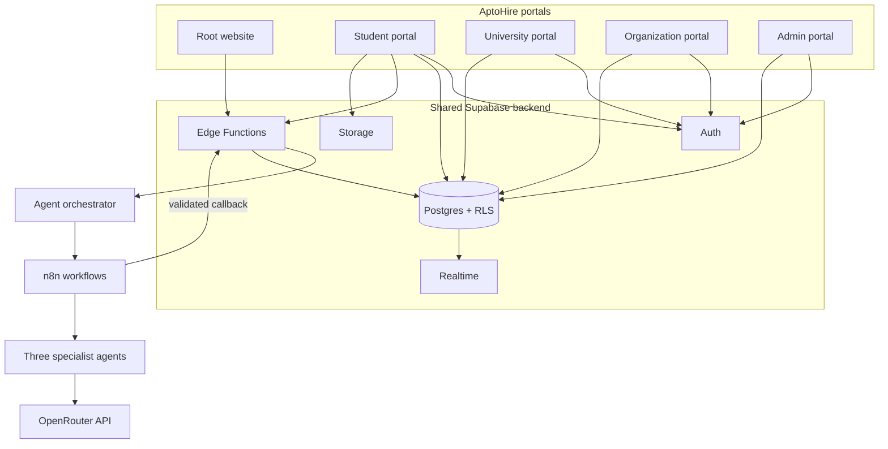

<div align="center">

# AptoHire

### Proof of skill. Privacy-first hiring.

A multi-portal platform that helps students demonstrate verified skills, helps universities understand skill readiness, and helps organizations discover candidates through evidence-backed, consent-first matching.


[Portals](#-the-five-portals) · [Architecture](#-how-the-pieces-fit-together) · [AI agents](#-ai--agent-workflows) · [Get started](#-get-started) · [Security](#-security--privacy)

</div>

---

<details open>
<summary><strong>🧭 Quick navigation</strong></summary>

- [What is AptoHire?](#-what-is-aptohire)
- [The five portals](#-the-five-portals)
- [How the pieces fit together](#-how-the-pieces-fit-together)
- [AI and agent workflows](#-ai--agent-workflows)
- [Get started](#-get-started)
- [Local development](#-local-development)
- [Configuration and secrets](#-configuration-and-secrets)
- [Security and privacy](#-security--privacy)
- [Testing and checks](#-testing-and-checks)
- [Working with Git submodules](#-working-with-git-submodules)
- [Troubleshooting](#-troubleshooting)

</details>

## ✨ What is AptoHire?

AptoHire is a skill-verification and hiring platform built around **evidence, privacy, and student consent**. Students submit real project work; the platform can create evidence-linked skill assessments and recommendations. Organizations can explore anonymized matches and request access; identity is revealed only within the applicable consent and access rules.

The project is organized as a **Git-submodule workspace**: this repository pins five portal repositories and one shared backend repository. The source code for each part remains in its own GitHub repository; the top-level repository records which commits are assembled together.

> [!IMPORTANT]
> A GitHub clone of this repository must initialize its submodules to download the portal and backend source. See [Get started](#-get-started).

## 🧩 The five portals

| Portal | Workspace path | Primary host | Purpose | Local port* | Source repository |
|---|---|---|---|---:|---|
| **Root** | `aptohire-root/` | `aptohire.com` | Public website, portal navigation, public credential verification | `5173` | [aptohire](https://github.com/Mansi-Kumawat/aptohire) |
| **Student** | `aptohire-student/` | `student.aptohire.com` | Projects, submissions, skill evidence, recommendations, profile and consent | `5174` | [aptohire-student](https://github.com/Mansi-Kumawat/aptohire-student) |
| **University** | `aptohire-university/` | `university.aptohire.com` | Roster and student-readiness workflows | `5175` | [aptohire-university](https://github.com/Mansi-Kumawat/aptohire-university) |
| **Organization** | `aptohire-organization/` | `organization.aptohire.com` | Jobs, anonymized candidate discovery and access requests | `5176` | [aptohire-organization](https://github.com/Mansi-Kumawat/aptohire-organization) |
| **Admin** | `aptohire-admin/` | `admin.aptohire.com` | Governance, approvals, review queues and administration | `5177` | [aptohire-admin](https://github.com/Mansi-Kumawat/aptohire-admin) |
| **Shared backend** | `aptohire-backend/` | Supabase project | Database, Auth, Storage, Edge Functions, policies and agent workflows | `54321` (local Supabase API) | [aptohire-backend](https://github.com/Mansi-Kumawat/aptohire-backend) |

\*Ports are the local-development plan in the project guide. Check each portal's own README and environment configuration if its current script differs.

## 🏗️ How the pieces fit together



- **Supabase** provides shared identity, data, file storage, real-time updates and server-side functions.
- **Row-Level Security (RLS)** and backend rules—not an AI response—enforce access, roles and consent.
- **n8n** coordinates configured AI workflows. The backend validates their inputs and results before storing or acting on them.
- The portal submodules can be developed and deployed independently while sharing the backend contract.

## 🤖 AI & agent workflows

AptoHire uses **one central orchestrator and three specialist (decentralized) agents**. The agents handle bounded tasks; they do not roam freely or make access-control decisions. The orchestration and AI design follows the uploaded product, agent and architecture documents.

| Layer / agent | Main responsibility | Example output |
|---|---|---|
| **Orchestrator** | Routes a task into the appropriate workflow, tracks its run, checks status and handles configured retry/fallback behavior | A validated, traceable agent run |
| **1. Proof & skill audit agent** | Reviews submitted work and available evidence; proposes rubric-linked skill scores and explanations for appropriate human review | Evidence references, scores, confidence and review flags |
| **2. Skill suggestion & project agent** | Suggests relevant skills and practical project briefs using the student's goals and skill context; uses the **OpenRouter API** for configured AI suggestions | Skill recommendations, project briefs and next steps |
| **3. Blind matching & profile agent** | Helps extract job skills, compare them with anonymized verified-skill profiles and suggest profile updates | Match reasons, skill gaps and profile proposals |

### Typical workflow

1. A portal submits a typed request to a Supabase Edge Function.
2. The orchestrator creates/tracks a run and dispatches it to the configured n8n workflow.
3. The appropriate specialist agent produces structured output. The skill-suggestion workflow can call OpenRouter from the server side.
4. The backend validates the response against the expected schema and applies business rules before updating data.
5. The portal receives status and results; uncertain or borderline work can be routed for human review.

### AI boundaries

- AI **suggests and assists**; deterministic backend rules and RLS enforce identity, consent, permissions and visibility.
- Student-provided text, code, documents and media are untrusted input—not instructions for the agent to follow.
- Outputs should be schema-validated and evidence-grounded. Failed AI calls should leave a recoverable state rather than silently changing a real user's result.
- Mock, direct-provider and n8n execution modes are described in the project design; which mode is active depends on each environment's configuration.

<details>
<summary><strong>🔐 OpenRouter and n8n secret handling</strong></summary>

- Keep `OPENROUTER_API_KEY`, Supabase service-role credentials, webhook/HMAC secrets and other provider keys in **server-side Supabase secrets or the n8n credential store**.
- Never put those values in frontend `VITE_*` variables, browser code, prompts, screenshots, README examples or Git commits.
- n8n should receive only the minimum task data needed. Use authenticated, signed callbacks; do not give a workflow database credentials or a service-role key.
- Use fictional or synthetic records for demos and tests. Do not send real student data to an AI provider unless the applicable consent, provider terms and data-handling requirements have been reviewed.

</details>

## 🚀 Get started

### 1. Prerequisites

- Git with submodule support
- Node.js and npm (use the version required by each submodule's README; Node.js 20 LTS is a good starting point)
- Docker and the Supabase CLI for local Supabase development
- Deno for checking/testing Supabase Edge Functions, where required
- n8n only if you are running the n8n workflow mode locally or on a development host

### 2. Clone the workspace with all six submodules

```bash
git clone --recurse-submodules https://github.com/Mansi-Kumawat/Code-aptohire.git
cd Code-aptohire
git submodule status --recursive
```

If you already cloned without the submodule contents:

```bash
git submodule update --init --recursive
```

### 3. Configure each app locally

Each portal and the backend has its **own environment template and README**. Copy the relevant example file to the local ignored environment filename described there (usually `.env.local`), then configure local URLs and public client settings. Do not copy production secrets into the browser app.

Use the local portal URLs/ports in the table above. The frontend's local Supabase URL is normally `http://127.0.0.1:54321` when using the Supabase CLI; use the actual local status output and each app's configuration guide.

### 4. Install and run the services you need

The top-level repository is an aggregator, not a single npm application. Install and run packages **inside the relevant submodule**. For example, the root portal has its own frontend package, while other submodules may use npm workspaces.

<details>
<summary><strong>Local Supabase backend</strong></summary>

From the backend submodule, follow its README and local environment setup. Typical local commands are:

```bash
cd aptohire-backend
npm install
npm run db:start
npm run db:reset   # Local development only; applies local migrations/seed data
npm run fn:serve   # Start local Edge Functions when configured
```

Use `npm run db:stop` when you are finished. Never run local reset or demo seed commands against a production project.

</details>

<details>
<summary><strong>Run a single portal</strong></summary>

Open that submodule's README first, then run its documented install and development commands. Example pattern:

```bash
cd aptohire-student
npm install
npm run dev
```

Available portal folders: `aptohire-root`, `aptohire-student`, `aptohire-university`, `aptohire-organization` and `aptohire-admin`.

</details>

## 🛠️ Local development

### Useful backend checks

Run these from `aptohire-backend/`, where the scripts are defined:

```bash
npm run check:static
npm run fn:check
npm run fn:test
npm run db:test
```

Some checks require Docker, Deno, a running local Supabase stack or local environment configuration. Read the backend README before running database commands.

### Portal checks

Run the commands listed in each portal's README/package scripts. Depending on the submodule, these commonly include:

```bash
npm run typecheck
npm run lint
npm run test
npm run build
```

Do not assume a root-level `npm test` exists in this aggregator repository.

## 🔒 Security & privacy

- **No secrets in Git.** Keep local `.env.local` files and provider/API keys out of commits. Track only safe example templates.
- **No privileged keys in the browser.** A Supabase anon key is a public client key; service-role and provider keys must remain server-side.
- **Consent before identity reveal.** Organization workflows should use anonymized views until the student grants the requested access.
- **RLS is the data boundary.** A frontend screen or AI response is not a substitute for database authorization.
- **Human oversight matters.** Borderline assessment results and sensitive policy changes require appropriate review.
- **Use synthetic demo data.** Never put real student records, resumes, identity documents or private code into public commits or unapproved AI prompts.

## 🧪 Testing and checks

The exact checks vary by submodule. At minimum, before proposing a change:

1. Run that submodule's typecheck, lint, unit tests and production build where available.
2. For backend/database changes, run the relevant Edge Function and pgTAP/RLS checks against **local or test** Supabase only.
3. For n8n changes, validate/export the workflow and test signed callback behavior in a development environment.
4. Review that no secrets, private student data or unapproved AI-provider payloads were added.

A successful local check does not, by itself, confirm a hosted Vercel, Supabase or n8n deployment.

## 🧷 Working with Git submodules

Each portal/backend is an independent repository. Make and push code changes inside the relevant submodule first, then update the pinned submodule commit in this aggregator:

```bash
# After committing the desired change in a submodule:
cd aptohire-student
git status
# Make/commit the change in this submodule and push it to its own remote.

# Return to the aggregator root:
cd ..
git status
git add aptohire-student
git commit -m "chore: update student portal submodule"
git push
```

To pull the pinned commits recorded by the aggregator later:

```bash
git submodule update --init --recursive
```

> [!NOTE]
> Committing at the aggregator root records a submodule pointer; it does not commit the files inside the submodule repository. Keep the submodule commit and aggregator pointer in sync.

## 🧯 Troubleshooting

<details>
<summary><strong>Portal folders are empty after cloning</strong></summary>

Initialize the submodules:

```bash
git submodule update --init --recursive
```

</details>

<details>
<summary><strong>Frontend cannot connect to Supabase locally</strong></summary>

Confirm the local Supabase stack is running, check the API URL/key printed by the local CLI, and verify the portal's `.env.local` values. Restart the frontend after changing Vite environment variables. Never paste keys into public issue reports.

</details>

<details>
<summary><strong>AI or n8n workflow fails</strong></summary>

Check the backend run status and server-side provider/workflow configuration. Confirm the OpenRouter credential is configured in the approved secret store, n8n is reachable, and callback signing matches the backend. Do not paste API keys, callback secrets or authorization headers into logs or chat. The application should use its configured retry/fallback path or offer a retry to the user.

</details>

<details>
<summary><strong>Submodule shows a modified or detached commit</strong></summary>

This is normal for pinned submodules. Check `git status` inside that submodule, decide whether to keep the currently pinned revision, and update the aggregator pointer only after the intended submodule commit is available on its remote.

</details>

## 📚 Project documents

The product, architecture and AI-agent summary above follows the supplied AptoHire specification and agent prompts. The backend repository also contains operational and security references:

- [Backend README](https://github.com/Mansi-Kumawat/aptohire-backend/blob/main/README.md)
- [Backend plan](https://github.com/Mansi-Kumawat/aptohire-backend/blob/main/docs/PLAN.md)
- [Backend runbook](https://github.com/Mansi-Kumawat/aptohire-backend/blob/main/docs/RUNBOOK.md)
- [Security notes](https://github.com/Mansi-Kumawat/aptohire-backend/blob/main/docs/SECURITY_NOTES.md)
- [Frozen contracts](https://github.com/Mansi-Kumawat/aptohire-backend/blob/main/docs/FROZEN-CONTRACTS.md)
- [Decisions and open items](https://github.com/Mansi-Kumawat/aptohire-backend/blob/main/docs/TODO_DECISIONS.md)

---

<div align="center">

**AptoHire — skills shown through evidence, shared with consent.**

</div>
